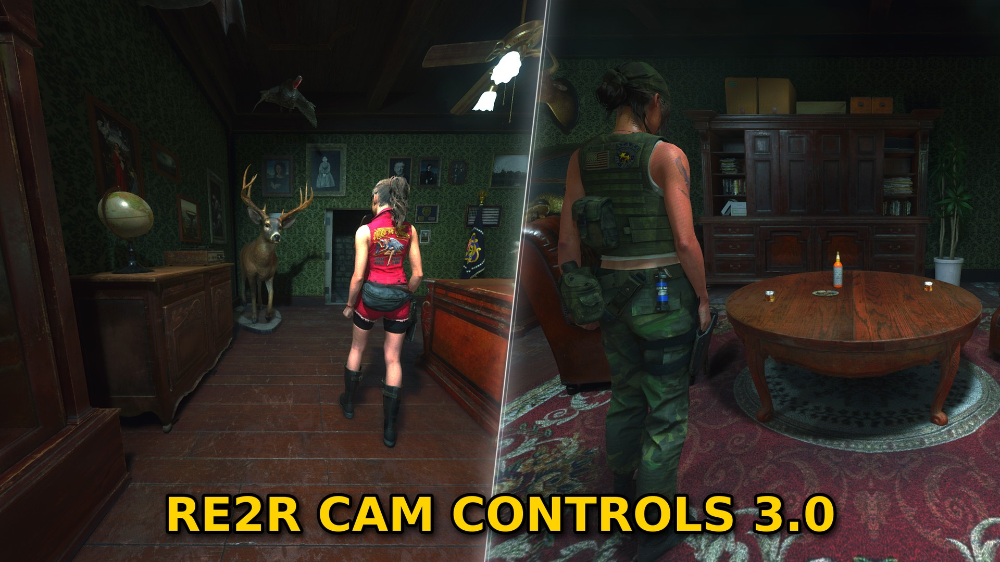
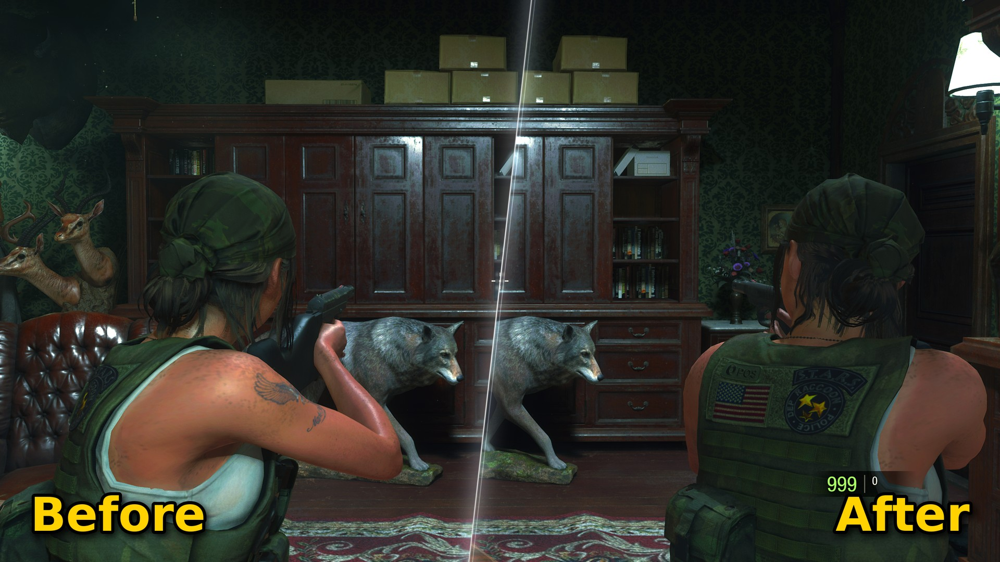
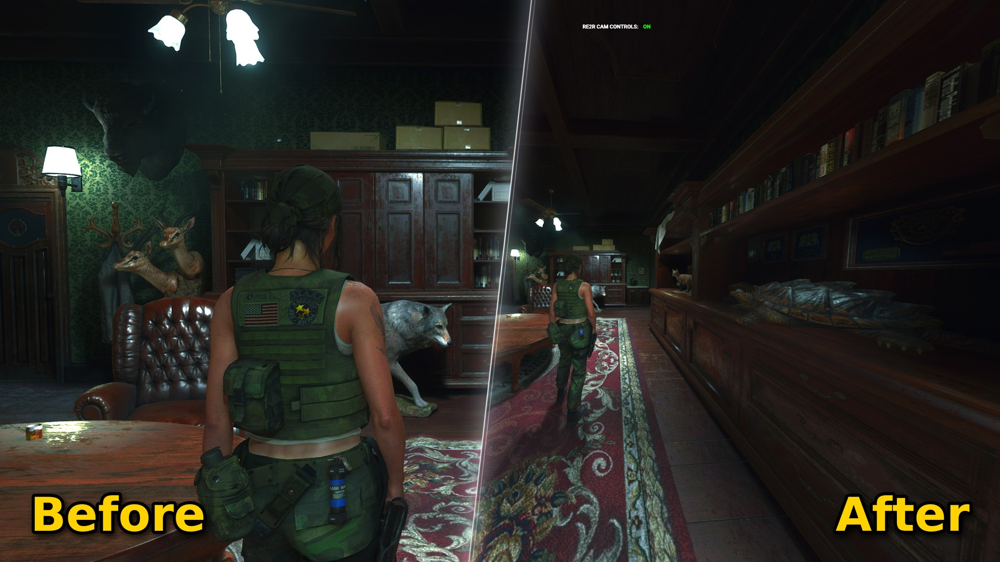
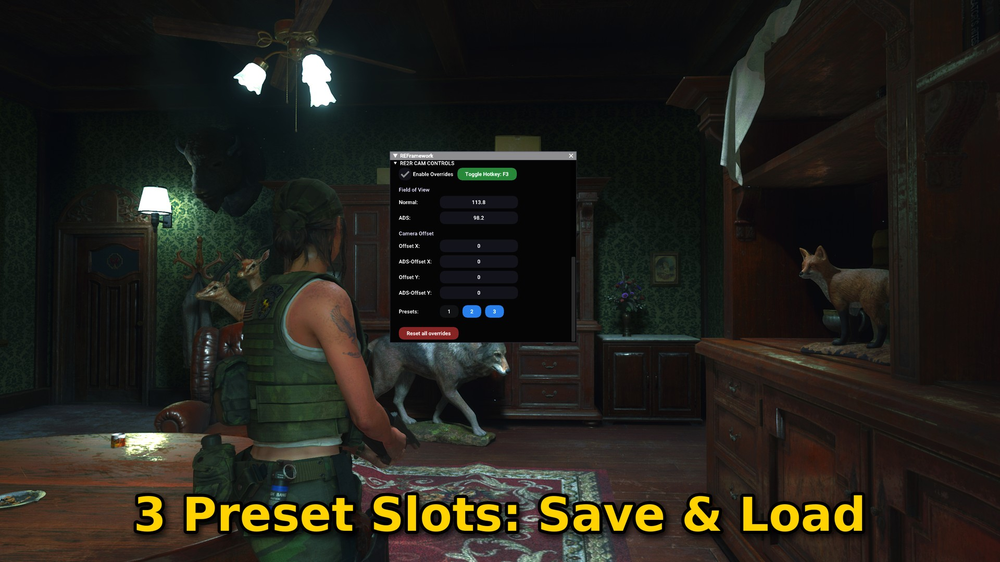

# RE2R CAM CONTROLS



A camera mod for **Resident Evil 2 Remake**, written as a single [REFramework](https://github.com/praydog/REFramework) Lua script.
It gives separate control over the normal and aiming field of view, a camera offset for the normal view and the aiming view, quicker camera transitions, and three preset slots. Everything is set from a menu inside REFramework.

**Version:** 3.0 · **Language:** Lua (REFramework API) · **Game:** Resident Evil 2 Remake (PC), tested on the non-ray-tracing (DX11) version

---

## Contents

- [Features](#features)
- [Repository layout](#repository-layout)
- [How it works](#how-it-works)
  - [Script structure](#script-structure)
  - [Field of view](#field-of-view)
  - [Aim zoom](#aim-zoom)
  - [Camera offset](#camera-offset)
  - [Transition timing](#transition-timing)
  - [What the script writes into the game](#what-the-script-writes-into-the-game)
  - [Settings file](#settings-file)
- [Development method](#development-method)
- [Compatibility](#compatibility)
- [AI use](#ai-use)
- [License](#license)
- [Installation](#installation)

---

## Features

| Feature | Details |
|---|---|
| Field of view | Separate **Normal** and **ADS** (aiming) FOV, 1.8° to 179° horizontal, far beyond the in-game setting. |
| Camera offset | Left/right and up/down offset for the normal camera, −100 to 100 cm. |
| ADS offset | Its own left/right and up/down offset for the aiming camera, covering every weapon and the knife. |
| Smooth aim zoom | Aiming in and out runs on one even 0.20 s curve, independent of the game's own zoom. |
| Quick transitions | The camera's position moves between views as fast as the FOV, so both finish together. |
| Presets | 3 slots, each saving the whole setup (both FOVs and all four offsets). Save, load, overwrite or clear. |
| Toggle | All overrides on/off with a hotkey (F1–F12, default F3), with a short on-screen ON/OFF notice. |
| Collision | Offsets are written into the game's own camera settings, so the game's wall collision still works. |
| Controller | Aiming with the left trigger is detected as well as the mouse. |
| Reset | "Reset all overrides" returns everything to the game's own camera; presets and the hotkey are kept. |

| Camera offset | Field of view |
|---|---|
|  |  |



---

## Repository layout

```
RE2R-CAM-CONTROLS/
├── RE2R_CAM_CONTROLS.lua   the mod (the exact file that ships in the release zip)
├── images/                 screenshots used in this README
├── CHANGELOG.md            changes in every version
├── CLAUDE.md               project notes for AI-assisted sessions
├── .gitattributes          keeps the script's Windows line endings byte-for-byte
└── .gitignore              files that never belong in the repo (e.g. your local settings)
```

---

## How it works

### Script structure

The script is one file, split into sections that each own one job:

| Section | Job |
|---|---|
| `CONFIG` | Loads and saves `RE2R_CAM_CONTROLS.json`; holds the settings table `cfg`. |
| `FIELD OF VIEW` | Reads the game's own FOV, works out the target value and sets it on the camera every frame. |
| `AIM ZOOM` | The 0.20 s zoom curve used when aiming in and out. |
| `CAMERA OFFSET` | Writes the two offsets into the game's camera settings and keeps them in sync. |
| `TRANSITION TIMING` | Shortens the game's camera transition timings while the mod is on. |
| `HOTKEY` | The toggle key and rebinding. |
| `TOGGLE NOTICE` | The fading "RE2R CAM CONTROLS: ON / OFF" text. |
| `UI` / `PRESETS` | The REFramework menu, the preset slots and Reset. |

Every access to the game goes through `pcall`, so a missing object or changed type makes that step do nothing instead of breaking the game. Lua allows 200 local names per chunk, so related state is grouped into tables (`preset`) and the transition section sits in its own `do … end` block.

### Field of view

- The sliders are **horizontal** FOV (what players are used to); the camera works in **vertical** FOV, so values are converted using the screen's aspect ratio.
- The game's FOV setting moves in 11 fixed steps (measured with read-only scans):
  - normal = 68.00 + 1.36 × step (68.00 to 81.60)
  - aim    = 55.00 + 1.10 × step (55.00 to 66.00)
- The game's normal value is **read live** from the camera, but only while the camera shows the plain normal view in normal play. That means no menu, inventory or item examine (`SurvivorRestrictionCollector.<MergedTarget> == 0`), not aiming (`PlayerActionOrderer.<Petient> ~= 16`), the normal camera kind (`BusyCameraController.<NowKind> == 0`) and no running hold (`<JogHold> == false`). A reading is accepted only if it lands exactly on one of the steps, so running, knife and special cameras can never be learned by mistake.
- The aim value is **calculated** from the normal value (same step), so the game never has to be aimed first.
- The result is held between hard limits whatever the inputs: above about 1° vertical (the game refuses anything lower and shows its default view) and below 179° horizontal (past 180° the projection turns inside out).
- The final value is set with `set_FOV` on the primary camera in `BeginRendering`, right before the frame is drawn.

### Aim zoom

The game's own zoom out of aim slows to a crawl near its end (well over half a second, measured frame by frame from video). Following it with far-apart sliders gave a slow creep and then a kick. So aiming in and out runs on its **own clock**:

- One curve of `SEG_TIME = 0.20` s from what is on screen to the target value.
- The curve is a smootherstep in "zoom" terms: the log of the tangent of half the angle. The picture grows or shrinks at an even pace even between very wide and very narrow views.
- After the curve the view holds its end value until the game has fully come to rest, then hands back to plain scaling of the game's value (same value, so no jump).
- Interrupted zooms (letting go mid-zoom, aiming again while zooming out) start a new curve from what is on screen.

### Camera offset

The offsets are not applied to the camera itself. They are written into the game's **camera settings**, so the game still does collision, interaction prompts and its own blending between views.

Where the settings live (found with read-only scans):

```
player → app.ropeway.camera.PlayerCameraPositionSetting → UserData
  → _Normal / _Jog → _Param → _Param → _Offset                    normal + running view
  → _Hold → _Params[n] → _UserData → _Param → _Param → _Offset    each weapon's aim view
  → _Hold → _Default → _Param → _Param → _Offset                  weapons without their own entry

camera → app.ropeway.camera.CameraSystem → BusyCameraController → OverwriteParam
  → _Normal / _Jog → _Offset                                      area overrides (e.g. the Main Hall)
```

- Each setting's original value is remembered per object for the whole session. Entering a room twice never stacks the offset, and a setting shared by several weapons is offset once.
- The game copies the active setting into its controller (`BusyCameraController → Param → PrevInfo / NextInfo`). That copy is updated too, so changes apply at once, even mid-aim. A copy is only touched if it exactly matches one of the mod's settings, so special cameras (typewriter, doors, cutscenes, grabs) are never affected.
- The game smooths the camera position (`DampingCameraPos`, 0.2 s). When an offset changes, the smoothing's current position is moved by the same amount, so the camera follows the mod's own 0.20 s ease instead of trailing behind.
- Everything is put back when an offset or the mod is turned off, when an area override stops being used, and when scripts are reset.

### Transition timing

Every move between views (normal, running, aiming, knife) uses a timing pair from the camera settings: *DampingRate of the way in DampingTime seconds*. Vanilla values (measured in game) are slow. For example, letting go of aim is 90% in 0.8 s and is still creeping after 1.5 s. With a 0.20 s FOV curve this showed as a small slide after the zoom.

While the mod is on, every timing is set to **90% in 0.15 s**, so position and FOV finish together.

How it is written safely:

- The timings are stored inline in `app.ropeway.camera.PlayerCameraTransitionParam` as `app.ropeway.DampingParam` structs: `_Input` at +24 (rate +24, time +28) and `_Output` at +32 (rate +32, time +36), all `System.Single`.
- Offsets are taken from the game's own type information at run time, not hard-coded.
- Before the first write, every number read straight from memory must equal the value from the game's own field lookup. If any differ, that setting is left alone.
- Each value is written as **one 4-byte float** at its own position and read back afterwards. Nothing else in the struct is touched.
- The original values are put back when the mod is turned off and when scripts are reset.

### What the script writes into the game

| Target | What | When it is put back |
|---|---|---|
| Primary camera | `FOV` (via `set_FOV`) | Mod off → the game's own value |
| Camera settings (normal, running, every aim entry, area overrides) | `_Offset` (Vector3) | Offset or mod off, override unused, script reset |
| Controller live copies (`PrevInfo` / `NextInfo`) | `_Offset`, only on exact match | Same as above |
| Camera position smoothing (`DampingCameraPos`) | `<Current>` moved by the offset change | Not needed (it is the game's moving position) |
| Transition timings (`PlayerCameraTransitionParam`) | 4 floats: `_Input` / `_Output` rate and time | Mod off, script reset |

Nothing else is written. Every scan used during development was **read-only**.

### Settings file

Saved automatically to `reframework\data\RE2R_CAM_CONTROLS.json`:

| Key | Meaning |
|---|---|
| `enabled` | Overrides on/off |
| `toggle_key` | Hotkey virtual-key code (default `0x72`, F3) |
| `fov_default`, `fov_ads` | Normal / ADS FOV; missing = follow the game exactly |
| `game_rest_raw` | The game's last read normal value, remembered between sessions |
| `cam_offset`, `cam_offset_y` | Normal-view offset in cm (+ right / + up) |
| `aim_offset`, `aim_offset_y` | Aiming-view offset in cm |
| `presets` | `p1`–`p3`, each holding the six values above |

Every stored value is checked on load: FOVs are kept within the slider limits, and offsets within whole centimetres from −100 to 100.

---

## Development method

- **Measure first.** Every game value and structure in this script was found with small read-only scan scripts that log what the game holds.
- **Scans never write.** Any build that writes into game memory states up front exactly what it writes (see the table above).
- **Own work.** Everything is reverse engineered for this mod; no other mod's code or methods are used.
- **Tested in game** across many scenarios before each release.

---

## Compatibility

- Requires REFramework. Tested on the **non-ray-tracing (DX11)** version of the game.
- Any other camera mod will conflict; only one should be active.
- Cutscenes use your custom FOV.
- v2.x settings (`RE2R_FOV_CONFIG.json`) are not read by v3.0.

---

## AI use

This mod was developed with AI assistance (Claude by Anthropic). All features were designed, tested and verified in game by me.

---

## License

The code is public for reading and learning. All rights reserved; reuse or redistribution requires permission.

---

## Installation

**Requirement:** REFramework, non-ray-tracing build: [RE2_TDB66.zip](https://github.com/praydog/REFramework/releases/latest/download/RE2_TDB66.zip). Extract `dinput8.dll` next to `re2.exe`.

**Manual**

1. Download the zip from [Releases](../../releases) (or `RE2R_CAM_CONTROLS.lua` from this repo).
2. Put `RE2R_CAM_CONTROLS.lua` in `RESIDENT EVIL 2  BIOHAZARD RE2\reframework\autorun`.
3. Launch the game. The menu is in the REFramework window under **Script Generated UI → RE2R CAM CONTROLS**.

**Uninstall**

Delete `RE2R_CAM_CONTROLS.lua` (and optionally `RE2R_CAM_CONTROLS.json` in `reframework\data`).
